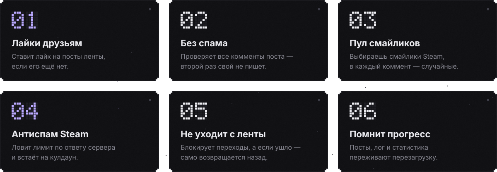
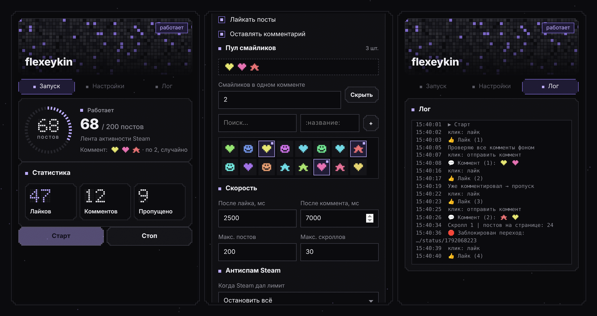

  

  
  
  
  

 

<b>Подробнее о каждой функции</b>

 

- **Лайки друзьям.** Проходит ленту активности, ставит лайк, если его ещё нет, и сам подгружает новые посты прокруткой.
- **Без спама.** Перед комментарием ищет твой коммент по SteamID, vanity-ссылке и смайликам из пула. Если на ленте видны не все комменты, страница поста проверяется фоном через `fetch`, без перехода.
- **Пул смайликов.** Кнопка «Мои смайлики» подтягивает смайлики твоего аккаунта картинками. Отмечаешь несколько, и в каждый коммент попадает от 1 до 5 случайных.
- **Антиспам Steam.** Фоновый скрипт читает ответ Steam на отправку комментария. На «posting too frequently» или HTTP 429 расширение останавливается (или продолжает только лайки) и включает кулдаун, а на иконке появляется бейдж ⏸.
- **Не уходит с ленты.** Переходы, вызванные скриптом, блокируются через Navigation API. Если переход всё же случился, расширение возвращается на ленту, пропускает виновный пост и продолжает.
- **Помнит прогресс.** Обработанные посты, счётчики и лог хранятся в `storage.local` и переживают перезагрузку страницы.

 

  
   
  Запуск · Настройки с выбором смайликов · Лог. Аватарка раскладывается в мозаику из твоей аватарки Steam, смайлики на скриншоте условные.

 

**Постоянная установка.** Скачай подписанный `.xpi` из [Releases](../../releases) и перетащи его в окно Firefox.

**Из исходников (временно, до перезапуска Firefox):**

1. Склонируй репозиторий.
2. Открой `about:debugging#/runtime/this-firefox` и нажми **«Загрузить временное дополнение»**.
3. Выбери `manifest.json`.

**Запуск:** открой свою ленту `steamcommunity.com/id/<ник>/home`, нажми иконку ♥ и затем **Старт**.

 

| Настройка | По умолчанию | Что делает |
|---|---|---|
| Лайкать посты | вкл | Ставить лайк, если его ещё нет |
| Оставлять комментарий | вкл | Комментировать посты без твоего коммента |
| Пул смайликов | `:CVRChanHeart:` | Из пула берутся случайные смайлики |
| Смайликов в одном комменте | 1 | От 1 до 5 |
| После лайка / коммента | 2500 / 7000 мс | Паузы со случайным разбросом ±15–25% |
| Макс. постов / скроллов | 200 / 30 | Ограничение одного запуска |
| Когда Steam дал лимит | Остановить всё | Или продолжать только лайки |
| Кулдаун после лимита | 30 мин | Сколько не комментировать после лимита |

 

| Файл | Роль |
|---|---|
| `content.js` | Работа на странице: лайки, проверка и отправка комментов, прокрутка, блокировка переходов, возобновление после ухода с ленты |
| `background.js` | Читает ответы Steam на комментарии (`webRequest.filterResponseData`), ловит лимит, ставит кулдаун и бейдж |
| `popup.*` | Интерфейс: мозаика аватарки, dot-matrix счётчики, кольцо прогресса, выбор смайликов, лог |
| `icons/` | Иконки: dot-matrix сердце для менеджера дополнений и пиксельное для панели |
| `tools/gen_readme_assets.py` | Генератор картинок для этого README |

Сборка не нужна, это чистый JS без зависимостей. Проверка: `npx web-ext lint`.

 

> [!WARNING]
> Массовые автоматические действия противоречат правилам Steam, и за них могут ограничить аккаунт. Расширение старается вести себя аккуратно: делает паузы, не пишет повторно и останавливается на лимите. Но ответственность за использование на тебе. Не уменьшай паузы и не запускай расширение на сотни постов подряд.

 

MIT · сделано <a href="https://github.com/flexeykinDev">flexeykin</a>

