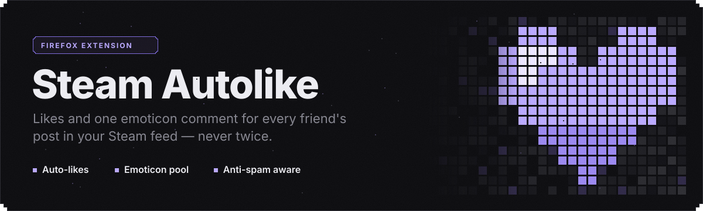
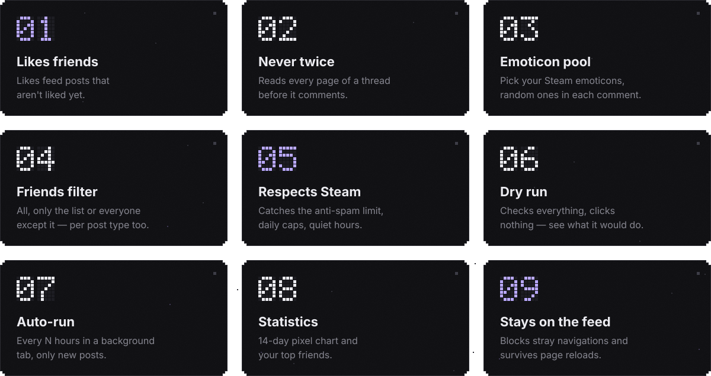
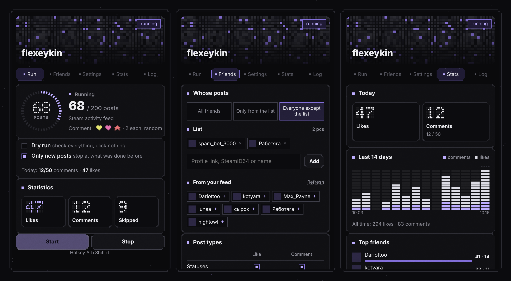
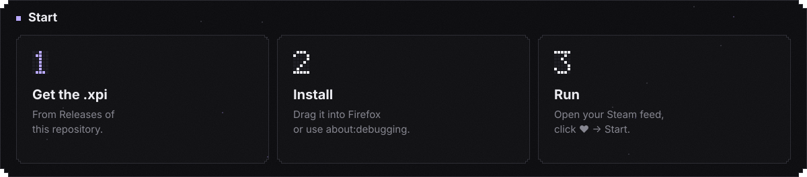

<p align="center"><b>English</b> · <a href="README.ru.md">Русский</a></p>

<p align="center">
  
</p>

<p align="center">
  <a href="https://github.com/flexeykinDev/steam-autolike/actions/workflows/ci.yml"></a>
  
  
  
  
</p>

A Firefox extension for your Steam activity feed. It likes your friends' posts and leaves a short emoticon comment (one per post, never twice). It also backs off when Steam's anti-spam kicks in.

<br>




<details>
<summary><b>More about each feature</b></summary>

<br>

- **Likes friends.** Walks the feed and likes posts that aren't liked yet. It scrolls by itself to load more posts.
- **Never twice.** Before commenting, it checks for your comment by SteamID, profile link and the emoticons in your pool. It reads **every page of the thread** through the same request Steam uses to page through comments (`/comment/<type>/render/…`), in the background and without leaving the feed. Threads it has already commented on are remembered too. If a thread can't be read completely, the post is skipped instead of being commented on blindly.
- **Emoticon pool.** *My emoticons* loads the emoticons on your account as images. Pick a few, and each comment uses 1–5 random ones. The default is `:steamhappy:`, which every account has.
- **Friends filter.** Choose all friends, only the ones on your list, or everyone except the list. You can add people by profile link, SteamID64, `[U:1:…]` or name, or pick them straight from your feed. Each post type (statuses, screenshots & art, reviews, games, other) can be set to like, comment, both or neither.
- **Respects Steam.** The background script reads Steam's answer to every comment. On *“posting too frequently”* or HTTP 429 it stops (or keeps liking only) and starts a cooldown, shown as ⏸ on the icon. Daily limits and quiet hours (they can wrap past midnight) keep runs modest.
- **Dry run.** Goes through the whole run and checks every thread, but clicks nothing. The log shows what it *would* have done.
- **Only new posts.** Stops after a streak of posts handled in earlier runs instead of scrolling through your whole history.
- **Auto-run.** Every N hours it opens your feed in a background tab, handles only new posts, and closes the tab. A notification sums up the run.
- **Statistics.** Today's counters against your limits, a 14-day pixel chart and your top friends.
- **Stays on the feed.** Navigations started by the script are cancelled through the Navigation API. If one slips through, the run returns to the feed, skips that post and carries on. Progress and the log survive page reloads.
- **Also:** `Alt+Shift+L` hotkey, settings export and import as JSON, English and Russian UI.

</details>

<br>


<p align="center">
  
  <br>
  <sub>Run · Friends · Stats. The header is a mosaic of your Steam avatar; the data in the screenshot is made up.</sub>
</p>

<br>




**Permanent install.** Download the `-signed.xpi` from [Releases](../../releases) and drop it onto a Firefox window. Regular Firefox only installs signed add-ons permanently. If a release only has an unsigned `.xpi`, use the temporary install below, or Firefox Developer Edition / Nightly with `xpinstall.signatures.required = false`.

**From source (temporary, until Firefox restarts):**

1. Clone the repository.
2. Open `about:debugging#/runtime/this-firefox` and click **Load Temporary Add-on…**.
3. Pick `manifest.json`.

**Use it:** open your feed at `steamcommunity.com/id/<you>/home`, click the ♥ icon and press **Start**. For the first run, turn on **Dry run** or set *Max posts* to around 10.

<br>


| Setting | Default | What it does |
|---|---|---|
| Like posts / Leave a comment | on / on | Master switches |
| Emoticon pool | `:steamhappy:` | Random emoticons are taken from here |
| Emoticons per comment | 1 | 1–5 |
| Friends: whose posts | All friends | All · only the list · everyone except the list |
| Post types | comment on statuses, media, reviews | Like / comment per type |
| Dry run | off | Check everything, click nothing |
| Only new posts | on | Stop after 6 posts in a row that were handled before |
| Likes / comments per day | ∞ / 50 | `0` = no limit |
| Quiet hours | off, 00:00–08:00 | No runs in this window |
| Run automatically | off, every 6 h | Background tab, only new posts |
| After a like / comment | 2500 / 7000 ms | Delays with ±15–25 % jitter |
| Max posts / scrolls | 200 / 30 | Per run |
| When Steam hits the limit | Stop everything | …or keep liking only |
| Cooldown after the limit | 30 min | No comments during the cooldown |
| Language | Auto | Follows the browser; English / Русский |

<br>


| File | Role |
|---|---|
| `content.js` | Runs on the feed: likes, full-thread comment check, posting, scrolling, navigation guard, resuming after a reload |
| `background.js` | Reads Steam's replies to comments (`webRequest.filterResponseData`), cooldown badge, auto-run alarm, notifications, hotkey |
| `lib/core.js` | Pure logic shared by everything and covered by tests: post type and author, friends filter, thread parsing, limits, quiet hours, stats, import validation |
| `lib/strings.js` | English and Russian UI strings. The log stores keys and is translated when shown |
| `popup.*` | The pixel dot-matrix interface |
| `_locales/` | Extension name and description per language |

**Privacy.** The extension only talks to `steamcommunity.com` (and loads emoticon and avatar images from Steam's CDN). Settings, history and statistics stay in `browser.storage.local`. Nothing is sent anywhere else.

<br>


```bash
npm install
npm test          # node --test + jsdom; fixtures are real Steam comment-thread markup
npm run lint      # web-ext lint
npm run build     # dist/steam-autolike-<version>.xpi
```

- **CI** runs tests, lint and the build on every push and PR. The `.xpi` is attached to the run as an artifact.
- **Releases:** bump `version` in `manifest.json`, add a section to [`CHANGELOG.md`](CHANGELOG.md) and push a tag `vX.Y.Z`. The workflow checks that the tag matches the manifest, builds the `.xpi` and publishes a GitHub Release with the changelog section as notes.
- **Signed builds:** add `AMO_JWT_ISSUER` and `AMO_JWT_SECRET` repository secrets (addons.mozilla.org → Developer Hub → *Manage API Keys*). The release workflow then also signs the add-on as *unlisted* and attaches the `-signed.xpi`.
- `tools/gen_readme_assets.py` regenerates the pictures in this README (EN and RU).

<br>


> [!WARNING]
> Mass automated actions go against Steam's rules and can get an account restricted. The extension tries to behave: it waits between actions, never comments twice, respects daily limits and stops on Steam's anti-spam. Still, how you use it is on you. Keep the delays and limits sensible.

<br>

<p align="center"><sub>MIT · made by <a href="https://github.com/flexeykinDev">flexeykin</a> · <a href="CHANGELOG.md">changelog</a></sub></p>
