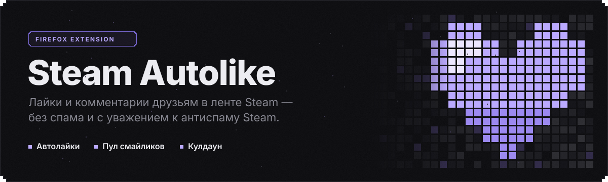
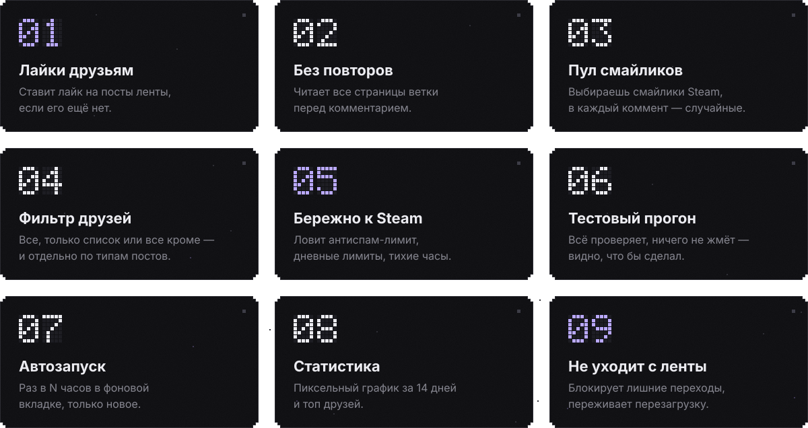
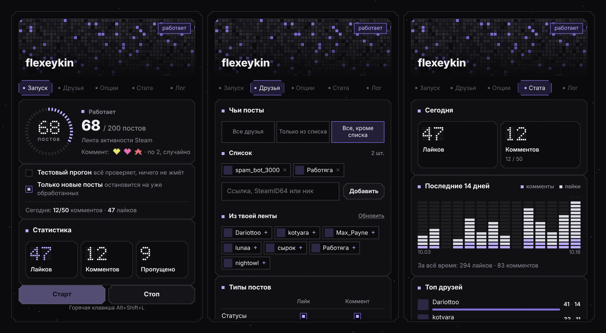
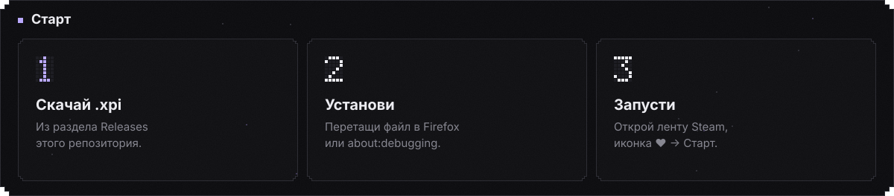

<p align="center"><a href="README.md">English</a> · <b>Русский</b></p>

<p align="center">
  
</p>

<p align="center">
  <a href="https://github.com/flexeykinDev/steam-autolike/actions/workflows/ci.yml"></a>
  
  
  
  
</p>

Расширение для Firefox для ленты активности Steam. Оно лайкает посты друзей и оставляет короткий коммент из смайликов, по одному на пост и никогда повторно. Когда включается антиспам Steam, расширение останавливается.

<br>




<details>
<summary><b>Подробнее о каждой функции</b></summary>

<br>

- **Лайки друзьям.** Проходит ленту и ставит лайк, если его ещё нет. Новые посты подгружает прокруткой сам.
- **Без повторов.** Перед комментарием ищет твой коммент по SteamID, ссылке на профиль и смайликам из пула. Читает **все страницы ветки** через тот же запрос, которым Steam листает комментарии (`/comment/<тип>/render/…`), фоном и не уходя с ленты. Ветки, где коммент уже оставлен, дополнительно запоминаются. Если прочитать ветку целиком не удалось, пост пропускается, а не комментируется вслепую.
- **Пул смайликов.** Кнопка «Мои смайлики» подтягивает смайлики твоего аккаунта картинками. Отмечаешь несколько, и в каждый коммент попадает от 1 до 5 случайных. По умолчанию стоит `:steamhappy:`, он есть у всех.
- **Фильтр друзей.** Режимы: все друзья, только из списка или все, кроме списка. Добавлять можно по ссылке, SteamID64, `[U:1:…]` или нику, а также одним кликом из ленты. Для каждого типа поста (статусы, скриншоты и арт, обзоры, игры, прочее) отдельно настраивается лайк и коммент.
- **Бережно к Steam.** Фоновый скрипт читает ответ Steam на каждый коммент. На *«posting too frequently»* или HTTP 429 расширение останавливается (или продолжает только лайки) и уходит на кулдаун, на иконке появляется ⏸. Ещё есть дневные лимиты и тихие часы, в том числе через полночь.
- **Тестовый прогон.** Проходит весь сценарий и проверяет все ветки, но ничего не нажимает. В логе видно, что расширение *сделало бы*.
- **Только новые посты.** Останавливается, когда пошли посты, обработанные в прошлых запусках, и не листает всю историю.
- **Автозапуск.** Раз в N часов открывает ленту в фоновой вкладке, проходит только новые посты и закрывает вкладку. Итог приходит уведомлением.
- **Статистика.** Счётчики за сегодня с учётом лимитов, пиксельный график за 14 дней и топ друзей.
- **Не уходит с ленты.** Переходы, которые запустил скрипт, отменяются через Navigation API. Если переход всё же случился, расширение возвращается на ленту, пропускает этот пост и продолжает. Прогресс и лог переживают перезагрузку.
- **И ещё:** горячая клавиша `Alt+Shift+L`, экспорт и импорт настроек в JSON, интерфейс на русском и английском.

</details>

<br>


<p align="center">
  
  <br>
  <sub>Запуск · Друзья · Стата. Шапка — мозаика из твоей аватарки Steam; данные на скриншоте условные.</sub>
</p>

<br>




**Постоянная установка.** Скачай `-signed.xpi` из [Releases](../../releases) и перетащи его в окно Firefox. Обычный Firefox насовсем ставит только подписанные дополнения. Если в релизе есть только неподписанный `.xpi`, используй временную установку ниже или Firefox Developer Edition / Nightly с `xpinstall.signatures.required = false`.

**Из исходников (временно, до перезапуска Firefox):**

1. Склонируй репозиторий.
2. Открой `about:debugging#/runtime/this-firefox` и нажми **«Загрузить временное дополнение»**.
3. Выбери `manifest.json`.

**Запуск:** открой ленту `steamcommunity.com/id/<ник>/home`, нажми иконку ♥ и затем **Старт**. Для первого раза включи **Тестовый прогон** или поставь «Макс. постов» около 10.

<br>


| Настройка | По умолчанию | Что делает |
|---|---|---|
| Лайкать / Комментировать | вкл / вкл | Главные переключатели |
| Пул смайликов | `:steamhappy:` | Отсюда берутся случайные смайлики |
| Смайликов в комменте | 1 | От 1 до 5 |
| Друзья: чьи посты | Все друзья | Все · только список · все, кроме списка |
| Типы постов | комменты на статусы, медиа, обзоры | Лайк и коммент для каждого типа |
| Тестовый прогон | выкл | Всё проверяет, ничего не жмёт |
| Только новые посты | вкл | Стоп после 6 уже обработанных подряд |
| Лайков / комментов в день | ∞ / 50 | `0` = без лимита |
| Тихие часы | выкл, 00:00–08:00 | В это время не запускается |
| Автозапуск | выкл, каждые 6 ч | Фоновая вкладка, только новое |
| После лайка / коммента | 2500 / 7000 мс | Паузы с разбросом ±15–25 % |
| Макс. постов / скроллов | 200 / 30 | На один запуск |
| Когда Steam дал лимит | Остановить всё | …или продолжать только лайки |
| Кулдаун после лимита | 30 мин | Пока идёт, комментов нет |
| Язык | Авто | Как в браузере; English / Русский |

<br>


| Файл | Роль |
|---|---|
| `content.js` | Работа на ленте: лайки, проверка всей ветки, отправка комментов, прокрутка, блокировка переходов, продолжение после перезагрузки |
| `background.js` | Читает ответы Steam на комменты (`webRequest.filterResponseData`), бейдж кулдауна, таймер автозапуска, уведомления, горячая клавиша |
| `lib/core.js` | Чистая логика, общая для всех частей и покрытая тестами: тип и автор поста, фильтр друзей, разбор веток, лимиты, тихие часы, статистика, проверка импорта |
| `lib/strings.js` | Строки интерфейса на английском и русском. Лог хранит ключи и переводится при показе |
| `popup.*` | Пиксельный dot-matrix интерфейс |
| `_locales/` | Название и описание расширения для каждого языка |

**Приватность.** Расширение обращается только к `steamcommunity.com` (картинки смайликов и аватарок грузит с CDN Steam). Настройки, история и статистика лежат в `browser.storage.local`. Никуда больше ничего не отправляется.

<br>


```bash
npm install
npm test          # node --test + jsdom; фикстуры — настоящая разметка веток комментов Steam
npm run lint      # web-ext lint
npm run build     # dist/steam-autolike-<версия>.xpi
```

- **CI** на каждый push и PR прогоняет тесты, lint и сборку. `.xpi` прикладывается к запуску как артефакт.
- **Релиз:** подними `version` в `manifest.json`, допиши раздел в [`CHANGELOG.md`](CHANGELOG.md) и запушь тег `vX.Y.Z`. Workflow сверит тег с манифестом, соберёт `.xpi` и опубликует GitHub Release, взяв описание из CHANGELOG.
- **Подписанная сборка:** добавь в секреты репозитория `AMO_JWT_ISSUER` и `AMO_JWT_SECRET` (addons.mozilla.org → Developer Hub → *Manage API Keys*). Тогда релиз заодно подпишет дополнение как *unlisted* и приложит `-signed.xpi`.
- `tools/gen_readme_assets.py` пересобирает картинки для README (EN и RU).

<br>


> [!WARNING]
> Массовые автоматические действия противоречат правилам Steam, и за них могут ограничить аккаунт. Расширение старается вести себя аккуратно: делает паузы, не пишет повторно, соблюдает дневные лимиты и останавливается на антиспаме. Но ответственность за использование на тебе. Держи паузы и лимиты разумными.

<br>

<p align="center"><sub>MIT · сделано <a href="https://github.com/flexeykinDev">flexeykin</a> · <a href="CHANGELOG.md">changelog</a></sub></p>
